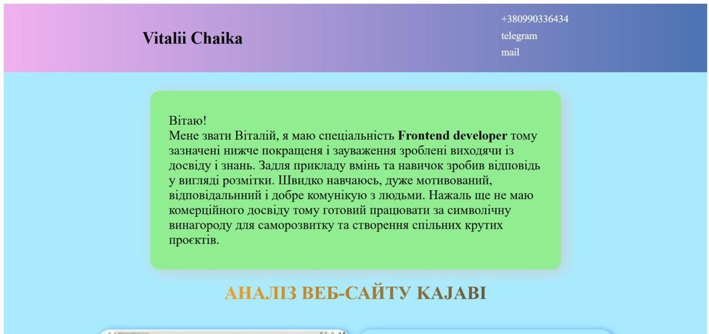

# Social Brand Haus — Kajabi Website Review

A one-page review of a Kajabi website prepared as a job application: found issues are shown as annotated screenshots with suggested improvements, presented as a responsive HTML/CSS layout.

**Live demo:** https://chaika911.github.io/Social_Brand_Haus/

## Stack

- HTML5
- CSS3 (Flexbox, media queries)

## Author

Vitalii Chaika — [portfolio](https://chaika911.github.io/myCV/) · [LinkedIn](https://www.linkedin.com/in/vitalii-chaika-dev/)
